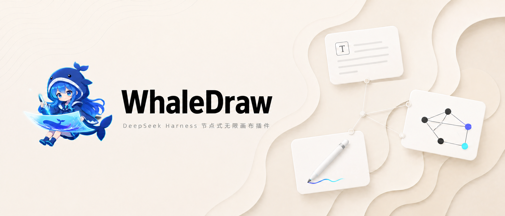
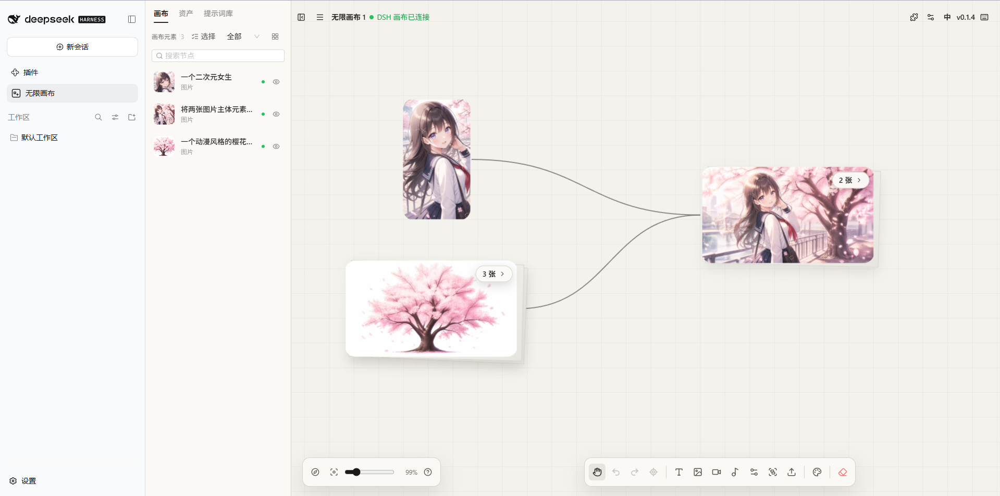
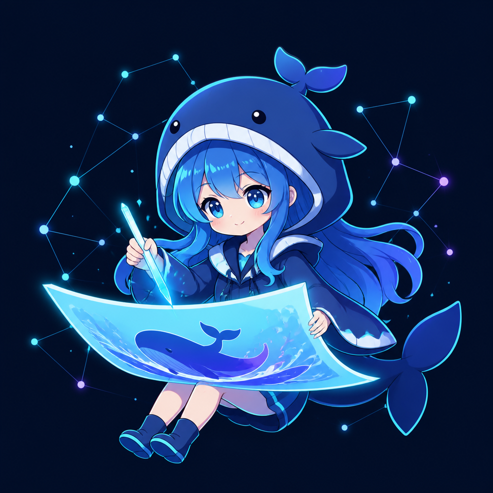

<p align="center">
  
</p>

<h1 align="center">WhaleDraw</h1>

<p align="center">
  <strong>把灵感铺开，让创作连接起来。</strong><br />
  在 DeepSeek Harness 中，用无限画布串联参考图、提示词与 AI 创作。
</p>

<p align="center">
  <a href="https://github.com/Prokint/WhaleDraw/releases/latest"><strong>下载安装</strong></a> ·
  <a href="#画布里的创作">功能预览</a> ·
  <a href="plugins/dsh-infinite-canvas/README.md">插件文档</a> ·
  <a href="LICENSE">MIT 开源</a>
</p>

---

## 画布里的创作

从一张参考图开始，在同一片画布上组织素材、尝试不同提示词，再继续迭代结果。

| 无限画布 | AI 创作 | DSH Agent |
| :--- | :--- | :--- |
| 用节点和连线组织图片、文本与创作思路。 | 图片与视频创作，配合提示词库和素材管理。 | 在聊天旁打开画布，让 Agent 读取与操作已连接的画布。 |

<p align="center">
  
  <br />
  <sub>参考图 → 素材组合 → 创作结果 · 截图来自较早版本，当前界面名称为 WhaleDraw。</sub>
</p>

## 开始使用

**1. 安装插件**

先安装并打开一次 DeepSeek Harness，完成初始化后彻底退出。从 [最新 Release](https://github.com/Prokint/WhaleDraw/releases/latest) 下载 `whaledraw-<版本号>.tgz`，将下方路径替换为安装包的绝对路径：

```powershell
dsh plugin --profile desktop add "file:<安装包的绝对路径>"
```

浏览器版 DSH 使用对应的 profile，例如把 `desktop` 改为 `web`。安装后手动重启 DSH。

**2. 打开你的画布**

点击侧栏的 **WhaleDraw**，进入「我的画布」，新建或打开项目。在 WhaleDraw 设置中配置模型接口与 API Key，即可开始创作；插件使用 DSH 提供的页面服务，无需额外启动前端服务。

**3. 和 Agent 一起创作**

在 DSH 会话中提出画布或生图请求，插件会引导选择已有画布、新画布或「生图工作台」，并打开对应页面连接 Agent。侧边栏与默认绑定画布不同时，可选择本次操作位置。

> 已安装 v0.1.4 或更早版本？首次切换到 WhaleDraw 更新来源需要手动安装；源码 `link:` 安装请按开发流程处理。先阅读 [升级与数据保护说明](plugins/dsh-infinite-canvas/README.md#仓库改名与更新来源)。

## 文档与开发

| 入口 | 内容 |
| :--- | :--- |
| [DSH 插件文档](plugins/dsh-infinite-canvas/README.md) | 源码构建、安装、Agent 连接与安全升级 |
| [项目文档索引](docs/index.md) | 独立运行、功能说明与开发文档 |
| [版本记录](CHANGELOG.md) | 本分支的更新内容 |
| [更新与上游同步](docs/content/docs/development/upstream-sync.mdx) | 独立发版、同步上游与冲突处理 |

画布、素材与记录保存在对应浏览器或 DSH WebView 的本地存储中，不会自动跨来源同步。模型 API Key 保存在浏览器本地，由前端直接请求所配置的模型接口；版本检查等功能仍需联网。

## 来源与许可

WhaleDraw 基于 [basketikun/infinite-canvas](https://github.com/basketikun/infinite-canvas)，保留完整画布应用并增加 DSH 插件适配。本分支独立维护与发版，保留上游作者署名，采用 [MIT 许可证](LICENSE)。

现有插件内部身份、连接协议和数据库标识沿用原名，已有安装与数据无需因品牌改名迁移。

<p align="center">
  
  <br />
  <sub>WhaleDraw · 让每一个灵感，都有展开的空间。</sub>
</p>
